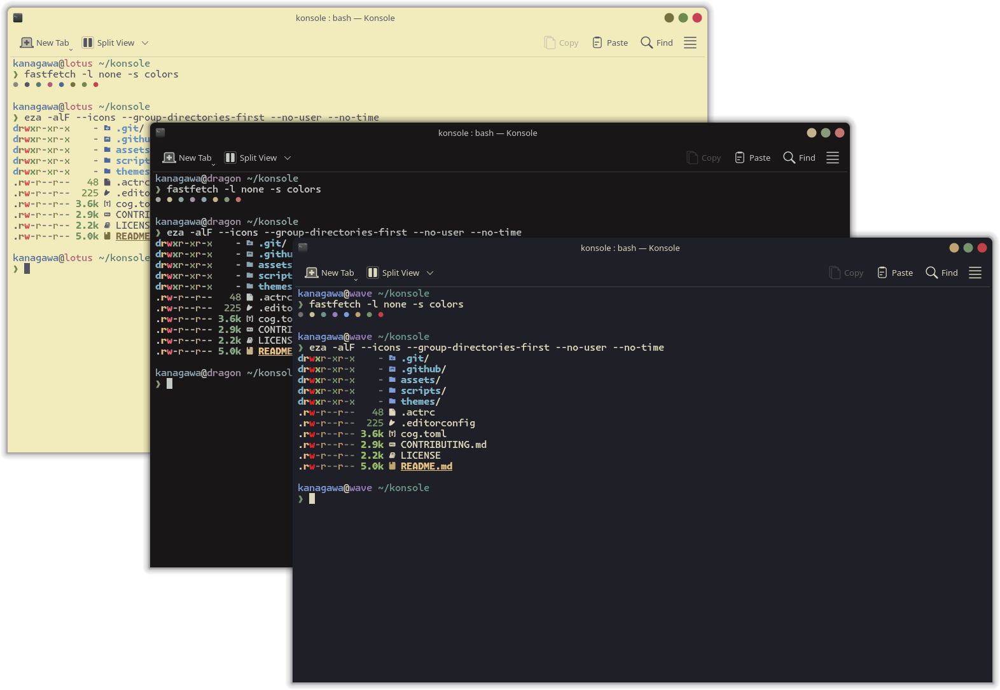
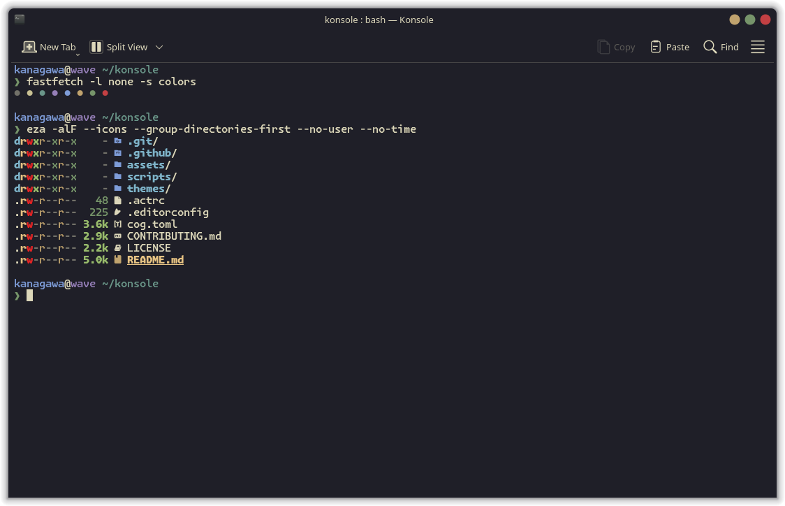
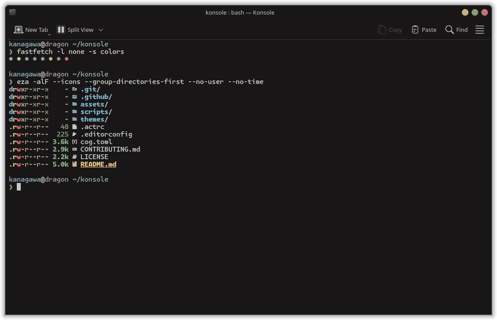
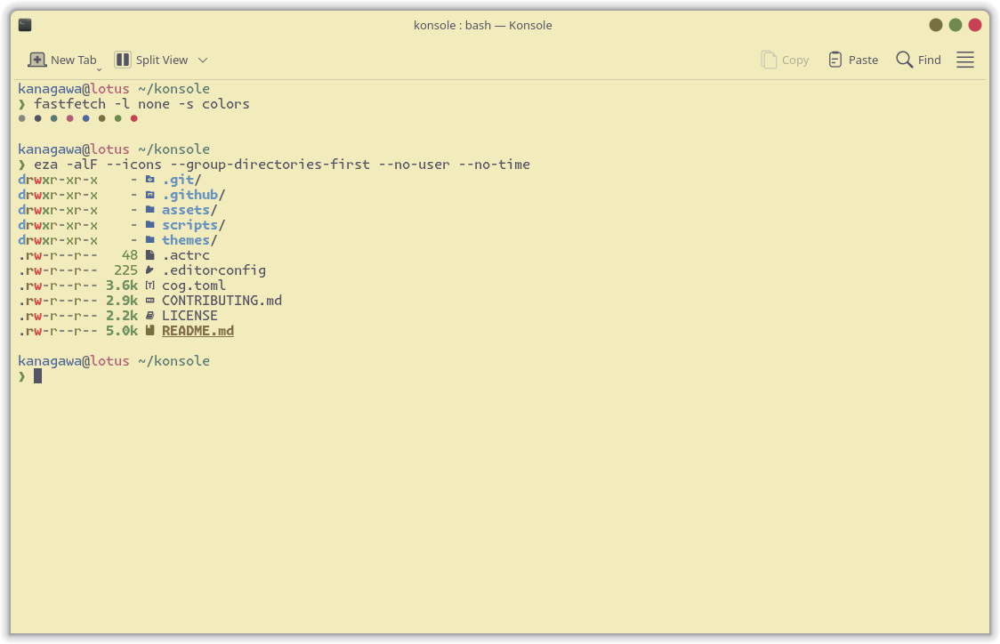

<h3>Kanagawa for <a href="https://konsole.kde.org">Konsole</a></h3>
<p>A community-maintained theme inspired by Hokusai's <em>The Great Wave off Kanagawa</em>.</p>
<p>Using the <a href="https://github.com/rebelot/kanagawa.nvim">Kanagawa palette</a> by <a href="https://github.com/rebelot">Tommaso Laurenzi (rebelot)</a>.</p>

<!-- Wave accents: carpYellow, crystalBlue, autumnRed. Lotus accents: lotusYellow, lotusBlue4, lotusRed. -->
<p>
  <a href="https://github.com/kanagawa-community/konsole/stargazers">
    <picture>
      <source media="(prefers-color-scheme: dark)" srcset="https://img.shields.io/github/stars/kanagawa-community/konsole?style=for-the-badge&amp;labelColor=1F1F28&amp;color=E6C384">
      <source media="(prefers-color-scheme: light)" srcset="https://img.shields.io/github/stars/kanagawa-community/konsole?style=for-the-badge&amp;labelColor=F2ECBC&amp;color=77713F">
      
    </picture>
  </a>
  <a href="https://github.com/kanagawa-community/konsole/releases/latest">
    <picture>
      <source media="(prefers-color-scheme: dark)" srcset="https://img.shields.io/github/v/release/kanagawa-community/konsole?style=for-the-badge&amp;label=release&amp;labelColor=1F1F28&amp;color=7E9CD8">
      <source media="(prefers-color-scheme: light)" srcset="https://img.shields.io/github/v/release/kanagawa-community/konsole?style=for-the-badge&amp;label=release&amp;labelColor=F2ECBC&amp;color=4D699B">
      
    </picture>
  </a>
  <a href="https://github.com/kanagawa-community/konsole/issues">
    <picture>
      <source media="(prefers-color-scheme: dark)" srcset="https://img.shields.io/github/issues/kanagawa-community/konsole?style=for-the-badge&amp;labelColor=1F1F28&amp;color=C34043">
      <source media="(prefers-color-scheme: light)" srcset="https://img.shields.io/github/issues/kanagawa-community/konsole?style=for-the-badge&amp;labelColor=F2ECBC&amp;color=C84053">
      
    </picture>
  </a>
</p>

<br clear="both">
<br>

## Previews



<details>
<summary>🌊 Wave</summary>

</details>

<details>
<summary>🐉 Dragon</summary>

</details>

<details>
<summary>🪷 Lotus</summary>

</details>

## Requirements

- Konsole.

## Installation

Download the color schemes into your Konsole data folder:

```sh
mkdir -p ~/.local/share/konsole
curl -fsSL -o ~/.local/share/konsole/kanagawa-wave.colorscheme https://raw.githubusercontent.com/kanagawa-community/konsole/main/themes/kanagawa-wave.colorscheme
curl -fsSL -o ~/.local/share/konsole/kanagawa-dragon.colorscheme https://raw.githubusercontent.com/kanagawa-community/konsole/main/themes/kanagawa-dragon.colorscheme
curl -fsSL -o ~/.local/share/konsole/kanagawa-lotus.colorscheme https://raw.githubusercontent.com/kanagawa-community/konsole/main/themes/kanagawa-lotus.colorscheme
```

Or clone the repository and run `./install.sh`. It installs all three variants,
or only the ones you name, for example `./install.sh dragon lotus`. `./uninstall.sh`
takes the same names and removes them.

## Usage

In Konsole, open **Settings > Edit Current Profile > Appearance**, select
**Kanagawa Wave**, and click **Apply**.

## Palette

Every color comes from the shared
[palette](https://github.com/kanagawa-community/.github/blob/main/docs/PALETTE.md),
picked by role, so each variant uses its own value for the same role.

| Konsole color                        | Palette role                 |
| ------------------------------------ | ---------------------------- |
| Background (all three)               | `ui.bg`                      |
| Foreground                           | `ui.fg`                      |
| Foreground faint                     | `ui.fg_dim`                  |
| Foreground intense                   | `term.bright_white`          |
| Color 0 to 7, and their faint shades | `term.black` to `term.white` |
| Color 0 to 7 intense                 | `term.bright_*`              |

## Issues and contributions

Report bugs and request changes in this port's
[issue tracker](https://github.com/kanagawa-community/konsole/issues). Contributions are welcome.

See [CONTRIBUTING.md](CONTRIBUTING.md) before opening a pull request.

## License

MIT. See [LICENSE](LICENSE).
